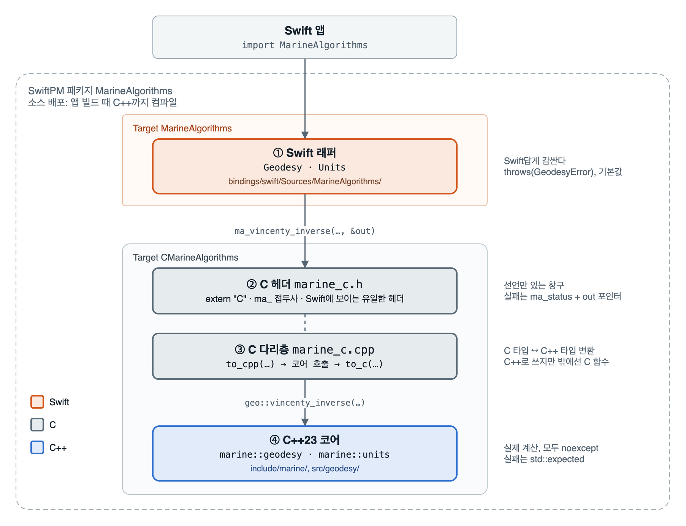

# marine-algorithms

해양·항해 계산 알고리즘을 모아 둔 C++23 라이브러리. C API를 거쳐 Swift(iOS·macOS)에서 쓰고, 이후 Kotlin(JNI)·WASM 바인딩을 같은 C 층 위에 올린다.

## 모듈

| 모듈 | 내용 | 상태 |
|---|---|---|
| `geodesy` | 구면 대권 거리·방위(하버사인) | 완료 |
| `geodesy` | 타원체 정문제·역문제(Vincenty) | 완료 |
| `units` | 단위 변환: m ↔ 해리(nm), m/s ↔ 노트(kn) | 완료 |
| `geodesy` | 항정선, 구면 목적지 좌표 | 예정 |
| `collision` | CPA / TCPA | 예정 |
| `interpolation` | 추측항법, 위치 보간 | 예정 |
| `filter` | 칼만 필터 | 예정 |

## 아키텍처

계산은 C++ 코어가 하고, Swift는 C 함수만 부른다. 가운데 C 다리층이 C 타입과 C++ 타입을 서로 바꾼다.



실패는 층을 넘을 때마다 그 언어의 방식으로 바뀐다. C++ 예외는 C 경계를 넘지 않는다.

| 층     | 성공                  | 실패                                             |
| ----- | ------------------- | ---------------------------------------------- |
| C++   | `std::expected`에 값  | `std::unexpected(GeodesyError::not_converged)` |
| C     | `MA_OK`, 결과는 `out`에 | `MA_NOT_CONVERGED`, `out`은 그대로                 |
| Swift | 값을 반환               | `throw GeodesyError.notConverged`              |

## 구조

```
include/marine/        C++ 공개 헤더 (marine::)
src/                   C++ 구현
bindings/c/            C 다리층 (ma_ 접두사, extern "C")
bindings/swift/        Swift 래퍼와 테스트
tests/cpp/             C++ 테스트 (Catch2)
tests/data/            테스트 기준값 (GeodTest 일부)
docs/DESIGN.md         설계 규칙
docs/ROADMAP.md        개발 계획
docs/gitflow.md        브랜치 전략(Git Flow)과 명령어
demo/                  SwiftUI 데모 앱
```

## 빌드와 테스트

```sh
# C++ (ASan + UBSan)
cmake -S . -B build -G Ninja -DMARINE_SANITIZE=ON
cmake --build build
ctest --test-dir build --output-on-failure

# Swift
swift test

# Swift + ASan·UBSan
# 기본 빌드 시스템(swiftbuild)은 UBSan 런타임을 링크하지 않아 링크 오류가 난다. native로 돌린다.
swift test --build-system native --sanitize=address --sanitize=undefined

# iOS 기기용 빌드 확인
xcodebuild -scheme MarineAlgorithms -destination 'generic/platform=iOS' build
```

## Swift에서 쓰기

```swift
.package(url: "https://github.com/indextrown/marine-algorithms.git", from: "0.1.0")
```

```swift
import MarineAlgorithms

let busan = Coordinate(latitude: 35.1028, longitude: 129.0403)
let fukuoka = Coordinate(latitude: 33.5902, longitude: 130.4017)
Geodesy.haversineDistance(from: busan, to: fukuoka)   // 구면 근사, ≈ 208 km
Units.metersToNauticalMiles(208_000)                  // ≈ 112.3 해리
Units.knotsToMetersPerSecond(12)                      // 12노트 ≈ 6.17 m/s

do {
    let r = try Geodesy.vincentyInverse(from: busan, to: fukuoka)   // WGS84
    print(r.distance, r.initialBearing)

    let d = try Geodesy.vincentyDirect(from: busan, bearing: 135, distance: 500_000)
    print(d.destination)   // 남동쪽 500km 지점
} catch .notConverged {
    // 대척점 근처. 하버사인으로 대신한다.
}
```

## 데모 앱

`demo/`에 예제를 목록으로 모아 둔 SwiftUI 앱이 있다. 상위 폴더의 패키지를 로컬로 연결하므로 라이브러리를 고치면 바로 반영된다.

```sh
open demo/MarineAlgorithmsDemo.xcodeproj
```

| 묶음 | 예제 |
|---|---|
| 측지 계산 | 하버사인 거리, Vincenty 역문제(하버사인과 비교), Vincenty 정문제, 대척점에서 실패하기 |
| 단위 변환 | 거리 m ↔ 해리, 속력 m/s ↔ 노트 |

iOS 17 이상에서 돌아간다. 예제를 더하려면 `demo/MarineAlgorithmsDemo/ExampleList/Example.swift`의 `Example`에 case를 추가하고 화면을 `Examples/` 아래에 만든다.

## 거리 계산 두 가지

| 함수 | 지구 모양 | 정확도 | 실패 |
|---|---|---|---|
| `haversine_distance` | 구 | 최대 약 0.5% | 없음 |
| `vincenty_inverse` / `_direct` | WGS84 타원체 | 0.1mm 이내 | 대척점 근처에서 역문제가 `not_converged` |
